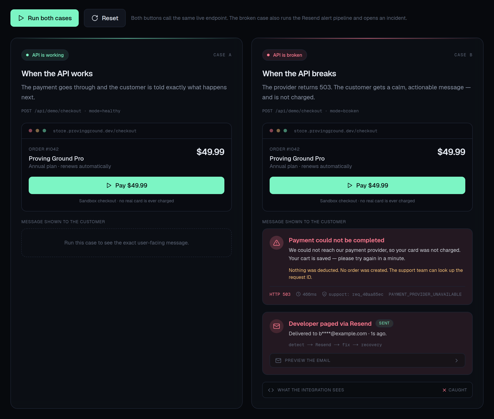
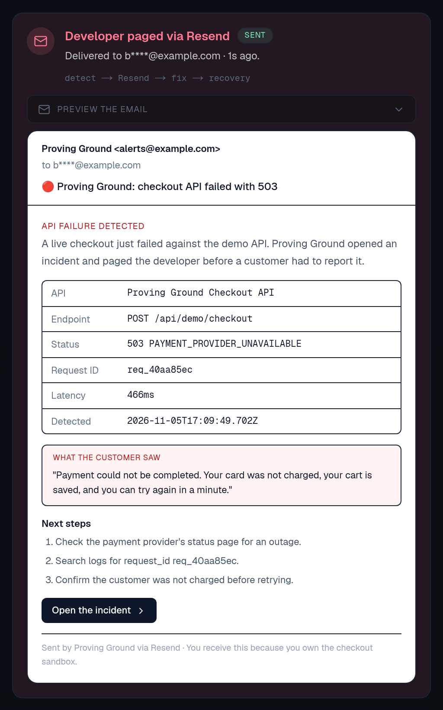
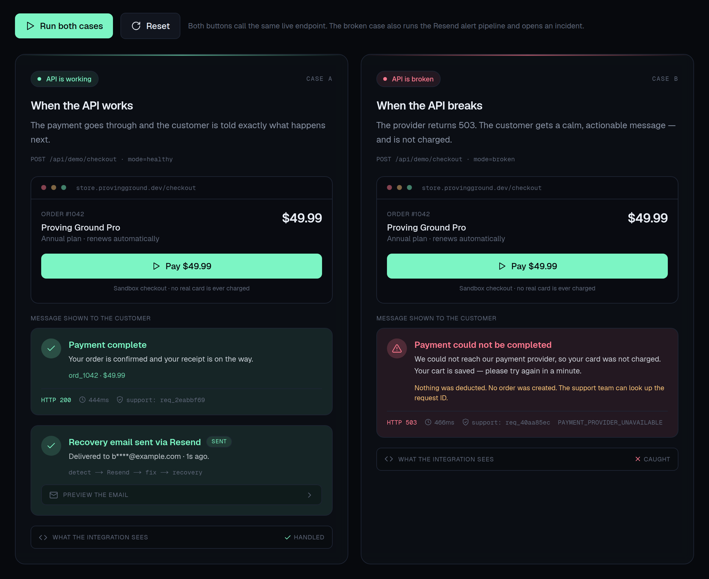

# Proving Ground

[](https://github.com/dsk-dev-ai/sandbox-bridge/actions/workflows/ci.yml)
[](https://github.com/dsk-dev-ai/sandbox-bridge/actions/workflows/live-demo.yml)
[](https://proving-ground.onrender.com/demo)

A two-sided sandbox bridge between the people who build software and the people who have to live with it.

Developers publish a runnable contract of their product — endpoints, realistic latency, honest failure rates, and the customer journeys that matter. Customers run those journeys under normal, stress, or chaos conditions and receive a timestamped proof report. Both sides see the same evidence before a contract, migration, or purchase is committed.

> No real payments move and no production traffic is touched. That is the point.

## Live demo

Open **<https://proving-ground.onrender.com/demo>** to see the working-vs-broken checkout, the exact customer message, and the Resend developer alert in one screen.

The broken case opens an incident, sends the developer an email with the request ID, latency, and customer-facing message, then suppresses duplicate alerts. The healthy case sends a recovery email and closes the incident.



<details>
<summary>Developer alert email preview</summary>



</details>

<details>
<summary>Recovery email after the API is healthy again</summary>



</details>

Every repository visitor can try it without signing in or entering a real card. To publish your own copy, follow [docs/DEPLOY_RENDER.md](docs/DEPLOY_RENDER.md). The `CI` workflow verifies every push, and the `Live demo check` workflow probes the public deployment every 30 minutes once the `DEMO_URL` repository variable is set.

## Why this exists

Most product evaluation is asymmetric. Developers prove things to themselves in staging. Customers make promises from a slide deck. The failures that matter only appear when a real workflow meets a real failure mode.

Proving Ground puts both parties in the same sandbox:

| Developer side | Customer side |
| --- | --- |
| Publish endpoints and mock responses | Browse a catalog of live sandboxes |
| Set latency and failure rates | Run persona-driven scenarios |
| Write assertion-based scenarios | Choose normal, stress, or chaos conditions |
| Publish when the contract is honest | Get a shareable proof report |

## What is included

- **Landing page** explaining the bridge, with live catalog stats.
- **Sandbox catalog** with search and industry filters.
- **Sandbox detail** with endpoints, response payloads, scenario flow, and an interactive runner.
- **Scenario runner** that animates the trace step by step and shows request/response bodies.
- **Proof reports** with readiness score, reliability, latency, expected vs actual contract, and failures.
- **Live two-case demo** at `/demo`: the same customer checkout calling a healthy API and a broken API, showing the exact user-facing message in each case, the technical trace, and a real developer email alert through Resend.
- **Developer studio** to create sandboxes, model endpoints, write scenarios, add steps, publish/unpublish, and delete.
- **Seeded demo sandboxes** across fintech, developer tools, privacy, and logistics. One scenario intentionally fails to demonstrate how the proof catches a real risk.
- **Local persistence** in SQLite via Node's built-in `node:sqlite` — no database service required.

## Quick start

```bash
npm install
npm run dev
```

Open <http://localhost:3000>. The database is created and seeded automatically at `data/proving-ground.db` on first request.

```bash
npm run lint       # eslint
npm run typecheck  # tsc --noEmit
npm run build      # production build + type checking
npm start          # run the production build
npm run db:reset   # delete the local database; demo data reseeds on next request
```

Requires Node.js 22.5+ for `node:sqlite` (Node 24 recommended).

## Live Resend alert demo

`/demo` runs two cases against the same endpoint: a healthy checkout (`200`) and a broken checkout (`503`). When the broken case runs, the app:

1. Records a `down` incident in SQLite.
2. Builds a developer alert with the status, request ID, latency, and the exact message the customer saw.
3. Sends it through Resend to `ALERT_TO_EMAIL`.
4. Suppresses duplicate DOWN emails for the same open incident.
5. Sends a recovery email and closes the incident the next time the healthy case runs.

Configure it in `.env.local`:

```bash
RESEND_API_KEY=re_...
ALERT_TO_EMAIL=you@example.com
ALERT_FROM_EMAIL="Proving Ground <alerts@yourdomain.com>"
DEMO_ALERT_COOLDOWN_SECONDS=180
# Optional, for the "Open the incident" link in the email:
APP_URL=https://proving-ground.example.com
```

`ALERT_FROM_EMAIL` must be a verified sender in Resend. For first-run testing, `onboarding@resend.dev` can deliver to the address that owns the Resend account.

Without a key, the pipeline still records every incident and the UI shows a preview of the email, but delivery is marked `skipped`. Set `DEMO_ALERT_COOLDOWN_SECONDS=0` when demoing to several buyers in a row. `RESEND_API_URL` can point at a local mock server during tests.

### Docker

```bash
docker build -t proving-ground .
docker run --rm -p 3000:3000 \
  -v "$PWD/data:/app/data" \
  -e RESEND_API_KEY=re_... \
  -e ALERT_TO_EMAIL=you@example.com \
  -e ALERT_FROM_EMAIL="Proving Ground <alerts@yourdomain.com>" \
  proving-ground
```

The named volume keeps sandboxes and proof reports between restarts.

## Publish on GitHub + Render

The repository is ready to publish so repo visitors see the live demo immediately:

- `render.yaml` defines the web service, a 1 GB disk for SQLite, and the required environment variables.
- `.github/workflows/ci.yml` runs lint, typecheck, build, and a smoke test of both checkout modes on every push.
- `.github/workflows/live-demo.yml` probes the public deployment every 30 minutes and shows a status badge.
- [docs/DEPLOY_RENDER.md](docs/DEPLOY_RENDER.md) walks through creating the GitHub repo, applying the Render Blueprint, adding the Resend secrets, and setting the `DEMO_URL` repository variable.

[](https://render.com/deploy?repo=https://github.com/dsk-dev-ai/sandbox-bridge)

If Render assigns a different service name, update the demo URL and badge in this README plus the `DEMO_URL` repository variable.

## How a run is scored

Each scenario step asserts a status code and an optional token that must appear in the response body. A step passes only when both match.

The simulation adds:

- **Normal** — the provider's published error rate and latency.
- **Stress** — 1.7x latency and +5 percentage points of failures.
- **Chaos** — 2.4x latency and +12 percentage points of failures.

The readiness score is weighted:

```
55% × pass rate
25% × reliability (1 - injected failure rate)
20% × endpoint coverage (endpoints exercised ÷ endpoints published)
```

A single happy-path scenario cannot fake a high score because coverage and reliability are part of the verdict.

## Routes

| Route | Purpose |
| --- | --- |
| `/` | Product story and live stats |
| `/demo` | Live working-vs-broken API demo with real fetch calls |
| `/catalog` | Published sandboxes |
| `/sandbox/[slug]` | Contract, scenarios, runner, recent runs |
| `/runs` | All proof reports |
| `/runs/[id]` | Detailed, shareable proof report |
| `/provider` | Developer studio dashboard |
| `/provider/new` | Create a sandbox |
| `/provider/[id]` | Edit endpoints, scenarios, publication |

### API

| Method | Route | Purpose |
| --- | --- | --- |
| `GET` / `POST` | `/api/sandboxes` | List or create sandboxes |
| `GET` / `PATCH` / `DELETE` | `/api/sandboxes/[id]` | Read, update, or delete a sandbox |
| `POST` | `/api/sandboxes/[id]/endpoints` | Add an endpoint |
| `DELETE` | `/api/endpoints/[id]` | Remove an endpoint (and dependent steps) |
| `POST` | `/api/sandboxes/[id]/scenarios` | Add a scenario |
| `DELETE` | `/api/scenarios/[id]` | Remove a scenario |
| `POST` | `/api/scenarios/[id]/steps` | Add a step |
| `DELETE` | `/api/steps/[id]` | Remove a step |
| `POST` | `/api/scenarios/[id]/run` | Run a scenario (`{ "mode": "normal" }`) |
| `GET` | `/api/runs` | List proof reports |
| `GET` / `POST` | `/api/demo/checkout` | Live demo endpoint; `mode=healthy` (200) or `mode=broken` (503) |
| `GET` / `POST` | `/api/demo/notify` | Alert history / run the down or recovery alert through Resend |

Try the demo endpoint directly:

```bash
curl -i "http://localhost:3000/api/demo/checkout?mode=healthy"
curl -i "http://localhost:3000/api/demo/checkout?mode=broken"
```

## Project layout

```
src/
  app/
    page.tsx                 landing
    catalog/                 customer catalog
    sandbox/[slug]/          sandbox detail + runner
    runs/                    proof report list and detail
    provider/                developer studio
    api/                     route handlers
  components/                nav, footer, UI, runner, studio editor
  lib/
    db.ts                    SQLite connection, schema, demo seed
    store.ts                 queries and mutations
    simulate.ts              scenario execution and scoring
    types.ts                 shared domain types
    utils.ts                 formatting helpers
    resend.ts                Resend email delivery
    demo-alert-template.ts   shared email + preview template
    demo-alert-store.ts      demo alert persistence
    demo-alert-service.ts    incident, dedupe, recovery, delivery
.github/workflows/           CI and live deployment check
docs/                        live-demo screenshots + Render guide
render.yaml                  one-click Render Blueprint
```

## Design decisions

- **No native dependencies.** `node:sqlite` ships with Node, so the demo starts with `npm install` alone.
- **Server-side simulation.** Contract rules, error injection, and scoring stay on the server. The client only animates the returned trace.
- **Immutable reports.** A run stores the mode, chaos level, latency, response status, response body, and assertion result for every step.
- **Drafts are previewable.** A draft sandbox is reachable by direct link but excluded from the catalog, matching how provider workspaces usually behave.

## Limitations and next steps

This is a complete local product demo, not a production SaaS. To take it further:

- Add authentication, organizations, and per-provider ownership.
- Replace mock responses with a real proxy layer and contract recordings.
- Move from SQLite to Postgres and add object storage for large traces.
- Add scheduled runs, webhooks, and pass/fail regression gates.
- Add customer comments on a proof report and provider responses.
- Add billing for private sandboxes and team seats.
- Turn the demo alert pipeline into per-user notification settings with retries, delivery webhooks, and additional channels. Today it delivers to one env-configured address and is intentionally demo-scoped.

The data layer is intentionally isolated in `src/lib/store.ts`, so swapping persistence does not require changing the UI.
